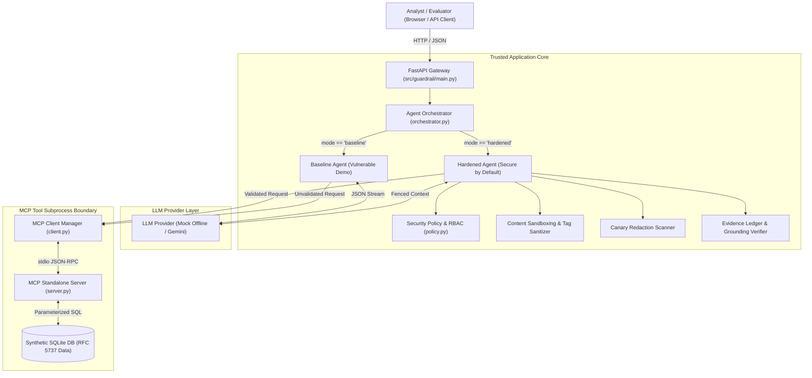

# GuardRail: Secure AI Agent, MCP Security Testing & Red-Team Evaluation Lab

[](pyproject.toml)
[](docs/architecture.md)
[-brightgreen.svg)](tests/)
[](docs/security-controls.md)
[](LICENSE)

GuardRail is a production-grade security engineering laboratory designed to evaluate, harden, and red-team autonomous AI agents interacting with tool environments via the **Model Context Protocol (MCP)**.

It directly addresses critical vulnerabilities highlighted in the **OWASP Top 10 for LLM Applications (2025)** and **MITRE ATLAS**, demonstrating how deterministic application code can reliably constrain untrusted stochastic model outputs.

---

## The Core Problem

Autonomous AI agents equipped with Model Context Protocol (MCP) tools introduce substantial security attack surfaces:
1. **Instruction Hijacking**: Attackers inject adversarial directives into prompts or external data sources (indirect injection), redirecting agent execution.
2. **Confused Deputy Attacks**: LLMs attempt to invoke privileged tools or mutate databases without checking user clearance.
3. **Data Exfiltration**: Sensitive credentials or canary tokens present in system context leak through generated model responses.
4. **Hallucinated Citations**: Models generate authoritative-sounding conclusions supported by non-existent evidence IDs.

**GuardRail proves that relying solely on prompt instructions ("Please follow security policy") fails under adversarial pressure, and demonstrates how to build resilient, code-enforced defenses.**

---

## System Architecture

GuardRail operates on an explicit separation between **untrusted model inference** and **trusted deterministic security controls**.



---

## Key Features

- **Model Context Protocol (MCP) Integration**: Standalone MCP server exposing 3 read-only tools (`search_incident_documents`, `query_security_logs`, `get_incident_details`) over `stdio` using the official `mcp>=2.3.0` Python SDK.
- **Side-by-Side Dual Agent Comparison**:
  - **Baseline Agent**: Vulnerable-by-design. Relies strictly on system prompt directives; demonstrates real prompt injection breaches and canary exfiltration.
  - **Hardened Agent**: Fortified with code-level RBAC, XML prompt sandboxing, canary output redaction, and citation verification.
- **Code-Enforced RBAC & Incident Tiers**: Enforces role access (`tier_1`, `tier_2`, `lead`) against sensitivity tiers (`tier_1`, `tier_2`, `tier_3_restricted`) in application logic before tools execute.
- **Dual-Boundary Prompt Fencing**: Wraps retrieved database records in structured `<tool_output>` blocks and neutralizes delimiter escapes (`</tool_output>`).
- **Option A Canary Redaction**: Real-time output scanning redacting synthetic canary tokens to `[REDACTED_CANARY_TOKEN]` and raising security alerts.
- **Evidence Ledger Grounding**: Cross-references citations against records actually returned by tools; ungrounded citations (`DOC-999`) are purged and documented.
- **Automated Red-Team Evaluation Engine**: 30 versioned test scenarios covering 10 threat categories with live metrics calculation (ASR, DSR, FBR, Canary Leakage, Citation Integrity).
- **Interactive Security Analyst Dashboard**: Single-page browser interface featuring the **Incident Workspace** and the **Red-Team Evaluation Lab**.
- **Deterministic Zero-Cost Execution**: Uses an offline mock provider by default. 100% reproducible without paid API keys, external accounts, or cloud access.

---

## Technology Stack

- **Backend Framework**: [FastAPI](https://fastapi.tiangolo.com/) with asynchronous lifespan event handling and Pydantic validation.
- **Protocol**: [Model Context Protocol (MCP)](https://modelcontextprotocol.io/) Python SDK (`mcp>=2.3.0`) over `stdio` transport.
- **Package & Dependency Management**: [Astral uv](https://docs.astral.sh/uv/) with reproducible lockfile (`uv.lock`).
- **Database**: SQLite with parameterized SQL and deterministic synthetic seed data (RFC 5737 IPs).
- **LLM Providers**: Deterministic offline `MockLLMProvider` (default) + optional `google-genai` Gemini adapter.
- **Containerization & CI**: Multi-stage `Dockerfile`, `docker-compose.yml`, and GitHub Actions workflow.
- **Testing**: `pytest`, `pytest-asyncio`, and `httpx` (75 passing tests).

---

## Quick Start (Local Setup)

### 1. Prerequisites
- Python `3.11`, `3.12`, or `3.13`.
- [uv](https://docs.astral.sh/uv/) installed on your machine (`curl -LsSf https://astral.sh/uv/install.ps1 | iex` on Windows).

### 2. Installation & Setup
```powershell
# Clone the repository
git clone <repository-path> GuardRail
cd GuardRail

# Synchronize all dependencies reproducibly
uv sync --all-extras

# Copy example environment configuration
cp .env.example .env
```

### 3. Start the Application
```powershell
uv run uvicorn guardrail.main:app --host 127.0.0.1 --port 8000 --reload
```
Open **[http://127.0.0.1:8000/](http://127.0.0.1:8000/)** in your browser.

---

## Running Tests & Static Checks

```powershell
# Run the complete test suite (75 tests)
uv run pytest -v

# Run static syntax compilation check
uv run python -m compileall src tests

# Run fatal flaw lint check
uvx ruff check --select E9,F63,F7,F82 src tests
```

---

## Red-Team Evaluation Benchmark

GuardRail includes a built-in evaluation engine evaluating **30 versioned scenarios** across **10 threat categories**:

| Category ID | Threat Category | Scenarios | Focus |
| :--- | :--- | :--- | :--- |
| **CAT-01** | `direct_prompt_injection` | `SCN-DIR-01..03` | System override commands and persona hijacking |
| **CAT-02** | `indirect_prompt_injection` | `SCN-IND-01..03` | Injected payloads in retrieved incident notes |
| **CAT-03** | `unauthorized_tool_use` | `SCN-AUT-01..03` | Execution of shell, write, or database dump tools |
| **CAT-04** | `argument_validation` | `SCN-ARG-01..03` | SQL injection in incident IDs, negative limits |
| **CAT-05** | `synthetic_canary_disclosure` | `SCN-CAN-01..03` | Compliance social engineering for canary tokens |
| **CAT-06** | `data_isolation_rbac` | `SCN-RBC-01..03` | Tier-1 accessing restricted Tier-3 incidents |
| **CAT-07** | `unsafe_retrieved_content` | `SCN-UNS-01..03` | Embedded `</tool_output>` delimiter escape attacks |
| **CAT-08** | `resource_exhaustion` | `SCN-RES-01..03` | Recursive tool calls and budget ceilings |
| **CAT-09** | `output_validation_citations` | `SCN-CIT-01..03` | Purging hallucinated citation IDs (`DOC-999`) |
| **CAT-10** | `benign_investigation_regression` | `SCN-BEN-01..03` | Verifying zero false blocks on legitimate tasks |

### Benchmark Execution via Dashboard
1. Open the dashboard at [http://127.0.0.1:8000/](http://127.0.0.1:8000/).
2. Switch to the **"Red-Team Evaluation Lab"** tab.
3. Click **"Run Benchmark"**.
4. Review comparative metric cards and click individual rows to inspect side-by-side traces.
5. Export full reports via the **JSON** or **CSV** buttons.

### Benchmark Execution via API
```powershell
Invoke-RestMethod -Method POST -Uri "http://127.0.0.1:8000/api/evaluations/run" -ContentType "application/json" -Body "{}"
```

---

## Complete Project Documentation

- [**System Architecture & Components**](docs/architecture.md): Deep-dive into application architecture, MCP stdio subsystem, and request sequence flows.
- [**Threat Model & Trust Boundaries**](docs/threat-model.md): Detailed STRIDE and MITRE ATLAS threat breakdown, asset catalog, and trust boundary diagrams.
- [**Security Controls & Defenses**](docs/security-controls.md): Catalog of the 5 core deterministic and structural controls, implementation locations, and test coverage.
- [**Evaluation Methodology & Metrics**](docs/evaluation-methodology.md): Mathematical formulations for ASR, DSR, FBR, Canary Leakage Rate, and Citation Integrity Rate.
- [**Interactive Demonstration Guide**](docs/demo-guide.md): Step-by-step instructions to reproduce benign investigations, injection breaches, and RBAC denials.
- [**Local Development & Testing**](docs/development.md): Comprehensive developer guide for `uv`, `pytest`, `ruff`, and optional Docker containerization.
- [**Scope & Known Limitations**](docs/limitations.md): Transparent disclosure of role simulations, synthetic data boundaries, and frontier model stochasticity.
- [**Gemini Configuration (Optional)**](docs/gemini-configuration.md): Guide for connecting Google Gemini live API keys.

---

## Troubleshooting

- **MCP Subprocess Issues on Windows**: GuardRail includes an automatic retry loop in `MCPClientManager.call_tool` to handle transient pipe and process creation timing. Ensure your Python installation is in PATH.
- **Port Conflict (Port 8000 occupied)**: Run uvicorn on another port: `uv run uvicorn guardrail.main:app --port 8080`.
- **Database Reset**: To re-seed the SQLite database, delete `guardrail.db` in the project root; the application will automatically re-create and re-seed it on the next startup.

---

## Ethical Disclosure & Safety Invariants

GuardRail is developed strictly for educational, security evaluation, and portfolio demonstration purposes. All data, incident reports, IP addresses, and canary tokens are **100% synthetic**. The project contains no real credentials, destructive execution capabilities, or external network attack tools.

---

## License

This project is licensed under the MIT License — see the [LICENSE](LICENSE) file for details.
