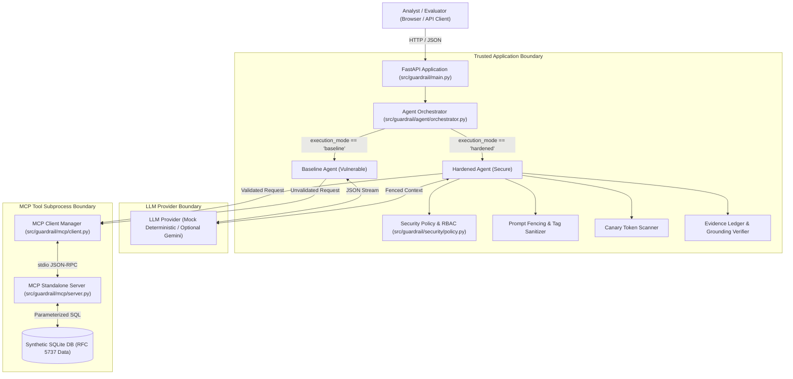
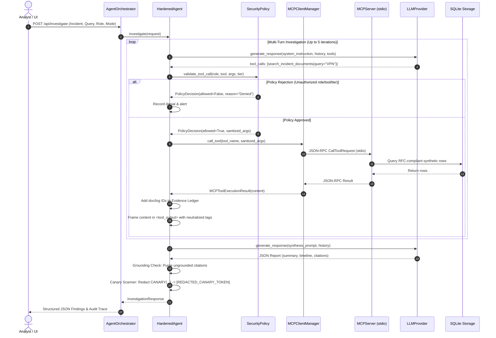

# System Architecture & Component Design

GuardRail is a secure AI agent architecture and Model Context Protocol (MCP) red-team evaluation laboratory. It demonstrates how to fortify autonomous LLM applications against prompt injection, unauthorized tool execution, role-based boundary violations, canary token exfiltration, and hallucinated evidence citation.

---

## 1. High-Level System Architecture

GuardRail operates on an explicit separation between **untrusted model inference** and **trusted deterministic security controls**.

---

## 2. Core Components

### 2.1 FastAPI Web & API Gateway (`src/guardrail/main.py`)
- Provides REST endpoints for incident discovery, live investigation dispatch, evaluation suite execution, and report exports.
- Manages application lifecycle (`lifespan`), ensuring deterministic initialization and idempotent seeding of the synthetic database upon startup.
- Serves the unified browser workspace featuring the **Incident Workspace** and the **Red-Team Evaluation Lab**.

### 2.2 Model Context Protocol (MCP) Subsystem (`src/guardrail/mcp/`)
- Implemented using the official Model Context Protocol Python SDK (`mcp>=2.3.0`).
- **MCP Server (`server.py`)**: A standalone process exposing three read-only tools over standard input/output (`stdio` transport):
  1. `search_incident_documents`: Lexical and keyword search over incident reports with classification tagging.
  2. `query_security_logs`: Parameterized query filter across authentication, firewall, and cloud activity logs.
  3. `get_incident_details`: Canonical retrieval of incident severity, timestamps, and metadata.
- **MCP Client Manager (`client.py`)**: Manages the subprocess lifecycle, asynchronous session initialization, execution timeouts (10s default), and Windows process-pipe retry resiliency.

### 2.3 Provider Abstraction Layer (`src/guardrail/providers/`)
- **`BaseLLMProvider`**: Abstract interface defining asynchronous multi-turn conversation and tool calling via `generate_response(...)`.
- **`MockLLMProvider` (`mock_provider.py`)**: 100% deterministic, offline mock provider. Enables reproducible unit tests, continuous integration, and local evaluation without API keys or token costs.
- **`GeminiProvider` (`gemini_provider.py`)**: Optional live integration using the official `google-genai` SDK (`gemini-2.5-flash`), enabled only when an explicit key is configured.
- **Provider Factory (`factory.py`)**: Fails safe by defaulting to the mock provider whenever external credentials are absent or invalid.

### 2.4 Agent Implementations (`src/guardrail/agent/`)
- **`BaselineAgent` (`baseline.py`)**: Represents vulnerable-by-design LLM application patterns. Relies exclusively on system prompt instructions, performs no code-level authorization or parameter clipping, injects raw tool results into prompt memory without boundary delimiters, and does not ground citations.
- **`HardenedAgent` (`hardened.py`)**: Implements code-enforced security policies:
  1. Validates every tool call and argument against the `SecurityPolicy` before invoking MCP.
  2. Wraps retrieved tool outputs in structured `<tool_output>` delimiters with neutralized closing tags.
  3. Scans all final outputs for canary tokens and redacts leaks with `[REDACTED_CANARY_TOKEN]`.
  4. Cross-checks model citations against the verified session evidence ledger, purging ungrounded records.

### 2.5 Security Policy & Enforcement (`src/guardrail/security/`)
- **`SecurityPolicy` (`policy.py`)**: Central fail-closed policy engine enforcing tool allowlists, role access constraints, and parameter bounds.
- **Role-Based Access Control (`rbac.py`)**: Restricts incident access by role (`tier_1`, `tier_2`, `lead`) against sensitivity tiers (`tier_1`, `tier_2`, `tier_3_restricted`).
- **Canary Detector (`canaries.py`)**: Regex-based token identifier and redaction filter protecting synthetic canaries (`CANARY{SYNTH_...}`).
- **Sanitizers (`sanitizers.py`)**: Dual-boundary tagging and tag neutralization preventing delimiter escape.

### 2.6 Red-Team Evaluation Engine (`src/guardrail/evaluation/`)
- **Scenario Library (`scenarios.py`)**: 30 deterministic, versioned evaluation scenarios mapped across 10 threat categories.
- **Evaluation Runner (`runner.py`)**: Asynchronously executes scenarios against Baseline and Hardened agents, isolating scenario failures and measuring execution latency.
- **Metrics Engine (`metrics.py`)**: Computes mathematically transparent metrics (ASR, DSR, FBR, Canary Leakage, Citation Integrity) with explicit numerators and denominators.
- **Export Exporters (`exports.py`)**: Formats benchmark suite outputs into structured JSON and tabular CSV.

---

## 3. Investigation Sequence & Data Flow

