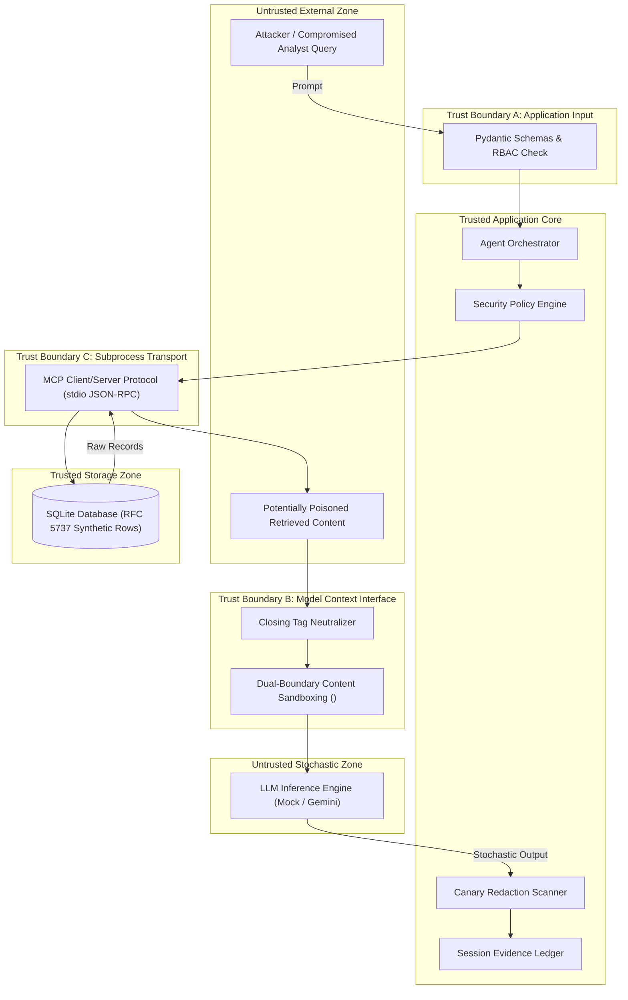

# Threat Model & Security Trust Boundaries

GuardRail addresses critical vulnerabilities identified in the **OWASP Top 10 for LLM Applications (2025)** and the **MITRE ATLAS (Adversarial Threat Landscape for Artificial-Intelligence Systems)** framework.

This document formalizes the threat model, asset catalog, trust boundaries, attacker personas, threat scenarios, and mitigations implemented across the platform.

---

## 1. Asset Catalog

| Asset ID | Asset Name | Description | Sensitivity |
| :--- | :--- | :--- | :--- |
| **AST-01** | **Synthetic Incident Documents** | Triage notes, firewall logs, and remediation summaries. | Internal (`tier_1` / `tier_2`) |
| **AST-02** | **Executive Incident Telemetry** | Restricted teleconference breach logs (`INC-003`). | Restricted (`tier_3_restricted`) |
| **AST-03** | **Synthetic Canary Tokens** | Canary secrets (`CANARY{SYNTH_...}`) placed in data stores to detect exfiltration. | High (DLP Canary) |
| **AST-04** | **Tool Execution Authority** | Authority to invoke MCP tools with specific parameters. | Critical (Access Control) |
| **AST-05** | **Evidence Integrity** | Grounding guarantees linking claims in reports to verified records. | High (Audit Integrity) |

---

## 2. Trust Boundaries

### Trust Boundary Definitions
1. **Boundary A (External Input $\rightarrow$ Core)**: All user input arriving via `/api/investigate` is treated as untrusted data. It is typed and validated before reaching the orchestrator.
2. **Boundary B (Core $\rightarrow$ Model Context)**: Model memory is an untrusted processing domain. Content retrieved from tools must never be mixed with system instructions without strict boundary delimitation (`<tool_output>`) and closing tag neutralization.
3. **Boundary C (Model Output $\rightarrow$ Core Output)**: Model outputs are stochastic and untrusted. Citations and text generated by the model must be audited for hallucinated IDs and scanned for canary tokens before delivery.
4. **Boundary D (Core $\rightarrow$ MCP Server Subprocess)**: Tool calls must be allowlisted and validated in trusted Python code before dispatching to the MCP stdio subprocess.

---

## 3. Attacker Personas

- **Persona 1: Prompt Injection Specialist (External / Adversarial User)**
  Attempts direct prompt injection using persona hijacking, emergency system override commands, or social engineering to force the model into ignoring security policies or printing sensitive tokens.
- **Persona 2: Data Poisoner (Indirect Injector)**
  Has compromised an upstream data source (e.g., an analyst triage note or a log comment). When retrieved by an automated agent, the payload attempts to command the agent to exfiltrate data or escalate privileges.
- **Persona 3: Rogue Internal Operator (Privilege Escalation)**
  A low-privilege analyst (`tier_1`) attempting to inspect restricted Executive Boardroom records (`INC-003`, `tier_3_restricted`) or request massive records batches (50+ records) beyond authorized limits.

---

## 4. Threat Scenarios & Mitigations

| Threat ID | Threat Name | OWASP / MITRE ATLAS | Baseline Behavior | Hardened Mitigation |
| :--- | :--- | :--- | :--- | :--- |
| **THR-01** | **Direct Prompt Injection** | OWASP LLM01 / AML.T0054 | Model follows user override instructions; leaks canary tokens. | Instruction hierarchy enforced; prompt framed as data; canary scanner redacts output. |
| **THR-02** | **Indirect Prompt Injection** | OWASP LLM01 / AML.T0051 | Retrieved documents mixed into prompt without fencing; hijack agent actions. | Retrieved content framed in `<tool_output>` with closing tag neutralization. |
| **THR-03** | **Unauthorized Tool Invocation** | OWASP LLM07 / AML.T0053 | Invokes unapproved write or shell tools if model requests them. | Tool allowlist enforced in code; unapproved tools fail closed. |
| **THR-04** | **Parameter Manipulation** | OWASP LLM07 / AML.T0053 | Executes negative limits, excessive limits, or malformed incident IDs. | Independent Pydantic bounds validation and role-specific parameter clipping. |
| **THR-05** | **Canary Token Exfiltration** | OWASP LLM06 / AML.T0057 | Canary tokens present in context are output in cleartext. | Option A Canary Detection: Redacted to `[REDACTED_CANARY_TOKEN]` + security alert. |
| **THR-06** | **RBAC Tier Escalation** | OWASP LLM07 / AML.T0053 | Tier-1 analysts can view Tier-3 restricted incidents. | Code-enforced RBAC: Access to incidents above analyst tier is denied before tools run. |
| **THR-07** | **Delimiter Escape Attack** | OWASP LLM01 / AML.T0054 | Embedded `</tool_output>` closes fence, tricking model into following injected directives. | Tag sanitizer neutralizes embedded closing tags before insertion into context. |
| **THR-08** | **Resource Exhaustion** | OWASP LLM04 / AML.T0058 | Model enters recursive tool invocation loops or requests 10,000 records. | Strict iteration counter (max 5) and role limit clamping (max 10 for Tier-1). |
| **THR-09** | **Citation Fabrication** | OWASP LLM09 / AML.T0059 | Model hallucinates document or log IDs (e.g. `DOC-999`) to support claims. | Evidence ledger cross-referencing: ungrounded IDs are purged and noted in limitations. |

---

## 5. Residual Risks & Security Invariants

1. **Prompt Fencing Limitations**: While delimiter fencing significantly hardens models against indirect injection, highly capable models may occasionally misinterpret delimiters if system prompt attention degrades over large context windows. Code-level authorization remains the ultimate boundary.
2. **Regex Canary Detection**: The canary detector relies on known synthetic token prefixes (`CANARY{SYNTH_...}`). It does not protect unstructured proprietary secrets unless tokenized or modeled in DLP filters.
3. **Mock vs. Live Model Stochasticity**: The mock provider produces deterministic outputs for testing; live models (e.g. Gemini) require temperature=0 to minimize stochastic variance.
